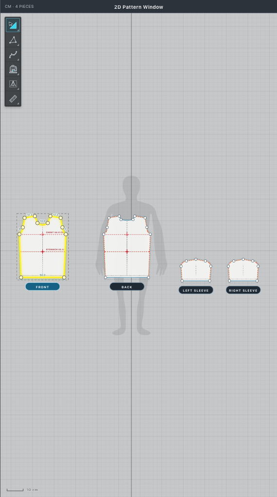
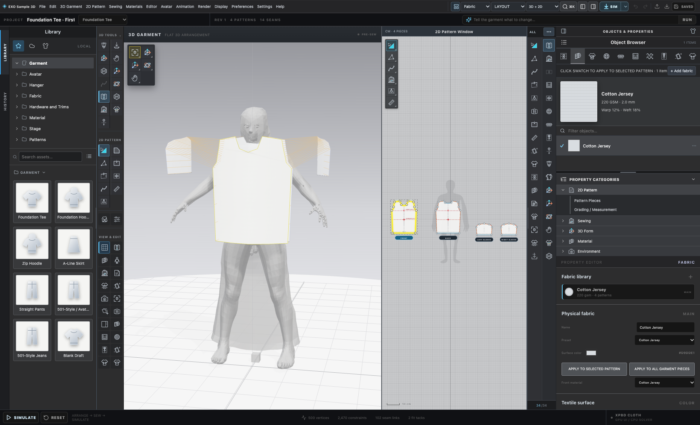
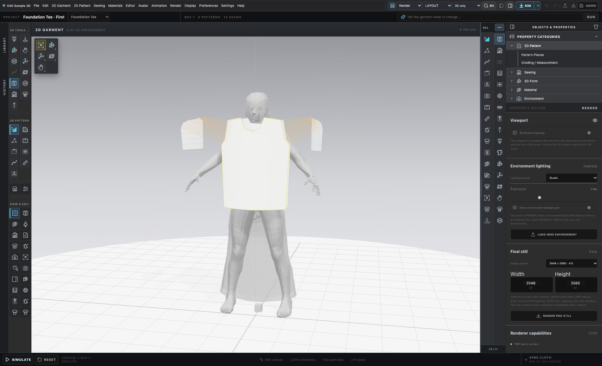
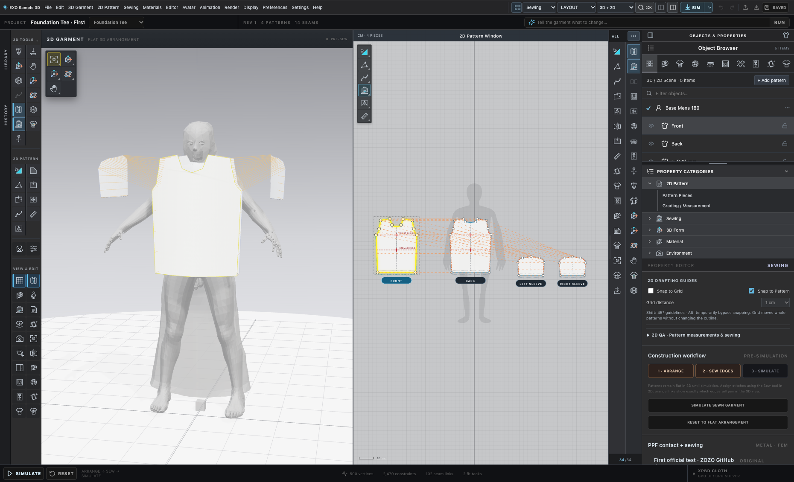

# EXO Sample 3D

**An open-source, experimental platform for fashion CAD, 2D patterns, 3D garments, cloth simulation, material visualization, and production engineering.**

EXO Sample 3D is a research-driven garment design workspace that aims to connect the entire apparel-development process: draft a pattern, sew digital panels, assemble and simulate fabric on an avatar, refine material behavior, grade sizes, visualize the product, and prepare manufacturing deliverables. The long-term goal is an extensible alternative workflow inspired by the capabilities designers value in tools such as CLO3D, without distributing proprietary software, artwork, model assets, or internal code.

**Project status: active development.** Pattern-editing and selected manufacturing operations have working tests; fitting physics, avatar contact, stable live cloth behavior and factory-ready exports remain under development. A screenshot, film or passing unit test is not a garment-fit certificate or a statement of feature-for-feature parity with commercial apparel CAD.

[Explore the system](#what-exo-sample-3d-can-do) · [Watch the V16 film](#v16--full-project-showcase-film) · [Latest screenshots](#latest-real-application-screenshots) · [Start locally](#quick-start) · [Detailed documentation](#project-documentation) · [Roadmap](docs/EXO_MASTER_ROADMAP.md) · [Contribute](CONTRIBUTING.md)

---

## V16 — full project showcase film

**[Play or download the complete V16 film (MP4)](media/exo-sample-3d-v16-showcase.mp4)**

- Full sequence: approximately **2 minutes 57 seconds**, with video and audio.
- GitHub repository copy: approximately **64 MB**, H.264/AAC, produced from the larger local master.
- The full film remains in the repository, rather than a link to an unavailable external service.
- The master render stays in local project storage; we keep generated masters out of normal Git history.
- The film documents the state of the product at V16 and may show work-in-progress simulation, fabric and UI behavior. It is **not a physics or manufacturing acceptance demonstration**.

See [media gallery and capture provenance](docs/EXO_MEDIA_GALLERY.md) for a list of images, source-session notes and review standards.

---

## Latest real application screenshots

These October 2026 captures come from the **current first-party EXO Sample 3D React/Three.js application** at an isolated Foundation Tee test session. They show a **neutral CC0 MakeHuman-derived fitting avatar**, its visible **3D floor grid**, editable garment patterns, sewing tools, fabric controls and the rendering workspace. None of these gallery frames are a simulated final garment fit; they show genuine pre-sewing/staging UI or workspace views. The avatar and floor-grid imagery is not a third-party CLO3D screenshot.

### 3D garment on the neutral grid

### Full CAD workspace: garment next to pattern pieces

| Current pattern drafting grid | Material workspace and 3D model |
| --- | --- |
|  |  |

| Render Studio with natural grid | Sewing and assembly workspace |
| --- | --- |
|  |  |

[View the dedicated 3D viewport](screenshots/exo-2026-current-3d-garment-grid.png) · [View the isolated fabric viewport](screenshots/exo-2026-fabric-viewport.png) · [All media notes](docs/EXO_MEDIA_GALLERY.md)

The source captures can be regenerated in a local checkout with a compatible Chrome installation using the gallery capture command described below. The capture is isolated from personal saved garments and uses the first-party Foundation Tee template.

---

## What EXO Sample 3D can do

Feature groups below distinguish a working implemented workflow from what still needs engineering verification.

| Area | Current functionality | Engineering status / next acceptance |
| --- | --- | --- |
| **2D pattern CAD** | Editable pattern geometry, points, curved edges, internal lines, notches and drafting tools | Working operations and regression tests; needs broader industrial pattern compatibility |
| **3D garment assembly** | 2D/3D linkage, garment-piece arrangements, sewn edges and staging around an avatar | Functional previews, but exact contact-safe assembled fit is not yet certified |
| **Sewing** | Full/partial seams, direction, stitching graph, easing/gather/elastic experiments | Semantics covered by targeted tests; complex zipper/virtual/contact cases remain under validation |
| **Fabric and materials** | PBR-like fabric controls, texture maps, weave families, photo-normal/roughness experiments | Editor and shaders exist; calibrated physical coefficients and cross-renderer parity are pending |
| **Avatars and size** | Measurement-driven procedural avatar and CC0 neutral MakeHuman base | Imported meshes can be visual-only; collision mesh validity differs by backend |
| **Cloth simulation** | Browser preview, experimental native XPBD sidecar and optional Rust PPF connector | Not yet a general, collision-certified, deterministic fit solver |
| **Production** | Pattern/grading data, BOM/POM, DXF, markers, HTML tech pack and factory ZIP generation | Many tools work; native package byte parity and physical factory acceptance are incomplete |
| **Export / integration** | OBJ/GLB, DXF, XML/CSV/JSON and external garment program adapters | Specific documented formats and fixtures are tested; industrial roundtrip fidelity needs independent review |
| **Render Studio** | Three.js scene, HDR/environment controls, still-image export and material previews | Interactive preview—not a certified path-traced or production-studio renderer |
| **Automation** | JSON document model, command palette and backend protocol | APIs are evolving; never assume an experimental command means an industrial feature is complete |

Read the full [feature atlas](docs/EXO_FEATURE_ATLAS.md) and [validation plan](docs/EXO_VALIDATION_TEST_PLAN.md) before relying on results for production.

---

## Core idea: one garment project, many engines

EXO Sample 3D keeps the pattern/garment document as the source of truth. It should be possible to switch viewing, simulation, export and production services without losing the underlying editable pattern or fabric metadata.

~~~text
EXO Sample 3D document
  ├─ 2D Pattern CAD ─────────────────── points, curves, seams, notches
  ├─ 3D Construction ───────────────── mesh, avatar staging, cloth panels
  ├─ Materials & Trims ─────────────── properties, optics, sewing metadata
  ├─ Solver adapters
  │    ├─ Browser preview (JavaScript / Three.js)
  │    ├─ Rust PPF contact solver (optional external service)
  │    └─ Native XPBD / C++ research backends (optional)
  ├─ Production preparation ───────── grading, BOM/POM, DXF, markers
  └─ Render / interchange ─────────── glTF/OBJ, image stills, JSON/XML
~~~

The original **Rust PPF** approach is retained. Finishing the entire C++ migration is **not required** for EXO Sample 3D to move forward. Existing native C++/Qt components are kept for research, regression comparisons and optional desktop integration.

For implementation details see [system architecture](docs/EXO_ARCHITECTURE.md), [data model](docs/EXO_DATA_MODEL.md), [simulation research](docs/EXO_SIMULATION_RESEARCH.md) and [backend API](docs/BACKEND_API.md).

---

## Quick start

### Requirements

- Node.js with npm (a current maintained LTS release recommended).
- Modern desktop browser with WebGL support; Google Chrome is used for many local UI regression captures.
- macOS or another OS capable of running the Vite development frontend.
- Extra native dependencies are optional; consult the backend documentation before enabling them.

### Run the browser workspace

~~~bash
git clone https://github.com/mikristian/exo-sample-3d.git
cd exo-sample-3d
npm ci
npm run dev
~~~

Open the local Vite address printed in your terminal (normally http://127.0.0.1:5173).

~~~bash
npm run build
npm run check:non-simulation
~~~

The browser CAD/editor is the lowest-friction starting point. **Do not assume that loading the editor means the Rust PPF or native XPBD service is installed.**

### Choose a simulation backend

**Browser preview** is available without a local native service. It is intended for iterative design feedback, not proof of cloth collision correctness.

**Rust PPF** is an optional separately installed research solver. Its external source and binary are not vendored in this GitHub repository.

~~~bash
npm run ppf:serve
npm run ppf:health
~~~

The PPF sidecar normally uses the loopback host on port 5192. Read [Rust backend setup](docs/RUST_BACKEND.md) and [simulation acceptance plan](docs/EXO_SIMULATION_RESEARCH.md) for prerequisites and limitations.

**Native XPBD / PositionBasedDynamics** is another optional path. macOS build tooling and a local upstream dependency clone may be required:

~~~bash
npm run dev:full
npm run check:native-service
~~~

The native sidecar uses the loopback host; actual port selection and build dependencies are documented in [developer guide](docs/EXO_DEVELOPER_GUIDE.md). It is an experimental backend, not a guaranteed replacement for the browser or Rust solver.

### Reproduce the latest screenshot gallery

~~~bash
npm run capture:gallery
~~~

Requires a local Google Chrome executable and the project dev server on port 5173. It captures a local **isolated testSession=tee** and does not read your regular saved garments. All gallery frames are real UI renders, not generated mock interfaces.

---

## Typical design-to-production workflow

1. **Create a garment** from a Foundation Tee, hoodie, pants or another supported starter and inspect its piece inventory.
2. **Draft the 2D pieces** using points, curves, measurement guides and internal construction lines. Preserve seam allowances and grain directions.
3. **Define sewing relationships** and verify boundary correspondence, sewing direction and staged placement in 3D.
4. **Choose an avatar** with suitable measurements. Use only assets with redistribution rights if sharing the project publicly.
5. **Assign materials** and inspect surface color, procedural weave, thickness, stretch, bending and material preview. Visual appearance and physical calibration are different tasks.
6. **Run an experimental preview**, checking against known failure modes: drift, body penetration, self-overlap, unstable seams, and inflated/stretched areas. Stop if the solver has not met acceptance criteria.
7. **Grade and measure** sizes only after checking POM conventions, layer overlap and construction constraints.
8. **Prepare manufacturing data** such as a BOM, graded DXF, markers and tech pack. Inspect each generated output against the original editable pattern and cutter requirements.
9. **Review production preflight blockers** and conduct a real sample validation. Generated files are not automatically approved factory instructions.
10. **Export and archive the project** using the canonical JSON model; keep design history, exact reference assets and test baselines traceable.

The [production guide](docs/EXO_PRODUCTION_PIPELINE.md) provides a more detailed process and file-level acceptance checklists.

---

## Project documentation

This repository includes **historic research logs** from October 2026 and a growing set of current, task-oriented manuals for contributors. Start with the [Documentation Index](docs/EXO_DOCUMENTATION_INDEX.md), which separates current guides from experimental notes.

| Deep-dive manual | What's inside |
| --- | --- |
| [Architecture](docs/EXO_ARCHITECTURE.md) | Module boundaries, UI/physics/production flow, interchange and service isolation |
| [Feature Atlas](docs/EXO_FEATURE_ATLAS.md) | Detailed capabilities and missing behavior for each editor and subsystem |
| [Canonical Data Model](docs/EXO_DATA_MODEL.md) | Project schema concepts, invariants, 2D/3D linkage and serialization |
| [Developer Guide](docs/EXO_DEVELOPER_GUIDE.md) | Local setup, command catalog, tests, APIs and debugging |
| [UI, Rendering and Avatars](docs/EXO_UI_RENDERING_AND_AVATARS.md) | Studio viewport, camera/grid, neutral 3D model, avatar formats and interface fidelity |
| [Fabric, Materials and Trims](docs/EXO_FABRIC_MATERIALS_AND_TRIMS.md) | PBR optics, physical textile parameters, colors and trim workflows |
| [Master Roadmap](docs/EXO_MASTER_ROADMAP.md) | Prioritized milestones, dependencies, implementation tasks and deliverables |
| [Simulation Research](docs/EXO_SIMULATION_RESEARCH.md) | Rust PPF/XPBD/JS comparison, stabilization, contact, physics and fit blockers |
| [Validation Test Plan](docs/EXO_VALIDATION_TEST_PLAN.md) | Benchmarks, fixtures, pass/fail criteria and repeatable verification |
| [Manufacturing Pipeline](docs/EXO_PRODUCTION_PIPELINE.md) | Grading, BOM/POM, DXF, marker, factory packaging and preflight |
| [Contributor Playbook](docs/EXO_CONTRIBUTION_GUIDE.md) | Review standards, subsystem ownership, good first issues and documentation hygiene |
| [Milestone Issue Board](docs/EXO_MILESTONE_ISSUE_BOARD.md) | 54 prioritized engineering tickets, dependencies and acceptance tests |
| [Project History](docs/EXO_PROJECT_HISTORY.md) | Dated architecture, feature development and experiment provenance |
| [Media Gallery](docs/EXO_MEDIA_GALLERY.md) | Recent screenshot index, rights provenance and V16 film status |
| [Release Readiness](docs/EXO_RELEASE_STATUS.md) | Public-source controls, current limitations and release checklist |

Additional system references: [Backend API](docs/BACKEND_API.md), [Existing architecture](docs/ARCHITECTURE.md), [Rust backend](docs/RUST_BACKEND.md), [Third-party licensing](docs/LICENSING.md), [Security](SECURITY.md), and the [legacy comprehensive parity plan](docs/GARMENT_STUDIO_COMPLETE_CLO3D_PARITY_MASTER_PLAN_2026-10-13.md).

---

## Roadmap at a glance

| Phase | Priority | Required result |
| --- | --- | --- |
| **01 — Baseline and reproducibility** | Immediate | Stable clean-checkout build, editor history, deterministic test garments, reliable CI |
| **02 — Geometry and sewing fidelity** | High | Consistent pattern edits, physical sewing constraints, measurable 2D/3D parity |
| **03 — Reliable fit on body** | Critical | Valid triangle contact, swept collision controls, robust seams and multi-frame convergence |
| **04 — Fabric realism and calibration** | High | Measured textile coefficients, consistent material mapping and controlled benchmark drape |
| **05 — Production handoff** | High | Exact graded geometry, vetted DXF, BOM/POM/markers, cutter-reviewed factory packages |
| **06 — Desktop / interoperability** | Planned | Native app parity where beneficial, resilient import/export and plugin architecture |
| **07 — Multi-user and automation** | Research | Versioned APIs, safe agent actions, provenance, releases and governance |

Progress is tracked through **measurable acceptance gates**, not a single headline completion percentage. In particular, mapping most exported functions into C++ does not imply a physically working, production-quality simulator.

Read the full [master roadmap](docs/EXO_MASTER_ROADMAP.md) for design constraints, ticket-level tasks, dependencies and test requirements.

---

## Repository map

| Path | Purpose |
| --- | --- |
| src/ | Main React app, UI components, garment-CAD domain logic, Three.js renderer |
| src/core/ | Geometry, drafting, sewing, simulation, materials, manufacturing and adapters |
| src/data/ | Sample templates and controlled test documents |
| scripts/ | Reproducibility, functional tests, visual QA and development tools |
| screenshots/ | October 2026 current-UI screenshots and V16 still |
| media/ | Full V16 showcase MP4 included with this repository |
| docs/ | Master manuals, architectural notes, test reports and historic experiments |
| native_backend/ | Native XPBD/solver sidecar and interop experiments |
| ppf_backend/ | Integration server for external Rust PPF runtime |
| native_cpp/ | Optional C++ core, CLI and Qt desktop research path |
| blender_bridge/ | Blender import/scene/render interchange tools |
| .github/ | CI, issues, discussions and contribution templates |

Research clones, generated binaries, proprietary reference avatars, local user projects, credentials, SDKs and video render intermediates are intentionally excluded from Git.

---

## Public-source safety and licensing

EXO Sample 3D original source is published under **GNU GPL-3.0-only** where rights are held; see [LICENSE](LICENSE). The project includes third-party components and CC0-origin MakeHuman reference assets that retain their own terms and notices. This repository does not provide the full upstream Rust solver, restricted CLO3D models, proprietary avatar files or other third-party datasets whose redistributable rights have not been established.

The project should be treated as **experimental engineering software**. No guarantee is made that a simulated garment will fit a human body, that cloth penetration is resolved, or that any automated manufacturing files are approved for industrial use.

For vulnerability reporting and responsible release handling see [SECURITY.md](SECURITY.md). For detailed third-party rights review see [docs/LICENSING.md](docs/LICENSING.md). Contributors must not add copyrighted garments/avatars, private API keys, licensed commercial software resources or confidential factory data without permission.

---

## Contributing

Constructive contributions are welcome in pattern CAD, physically credible cloth simulation, mesh topology, avatar/collision systems, material calibration, performance, visual tooling, export fidelity and test infrastructure.

1. Read [CONTRIBUTING.md](CONTRIBUTING.md), the [developer guide](docs/EXO_DEVELOPER_GUIDE.md) and [contributor playbook](docs/EXO_CONTRIBUTION_GUIDE.md).
2. Choose a reproducible issue with a clear fixture and expected behavior.
3. Supply the smallest change possible, plus focused tests and parity diagnostics.
4. Keep provenance and third-party license notices in your PR.
5. Do not report passing CTest alone as complete physical-fit certification.
6. Discuss changes to the canonical garment document format or solver-backend contract before merging.

**EXO Sample 3D is a work in progress, built for people who want to make digital clothing creation more open, inspectable and extensible.**
