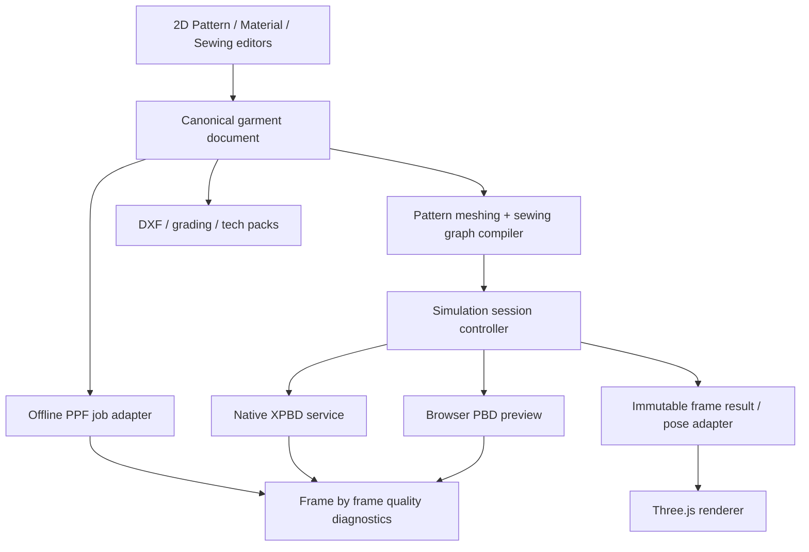

# Garment Studio · architecture and cloth simulation audit

**Date:** 2026-10-13  
**Scope:** Live garment code in `/Users/mikylecouto/Chat On Steroids Workspace/garment-studio`. Findings are drawn from inspected source and named test runs. This is **not** a claim that the T-shirt has passed fit acceptance.

## Executive assessment

The core product boundary is sound in principle: the editable garment document owns pattern/sewing/fabric data independently of the 3D renderer. The actual implementation still joins assembly, numerical solving, body collision, telemetry and rendering in two large modules. **Correct physical fit is not production-validated on any current solver.**

| Subsystem | Current implementation | Audit status |
| --- | --- | --- |
| Pattern/garment document | `src/data/templates.js`, `src/core/project.js`, `src/core/grading.js` | Editable and exportable; tee geometry/graded seam-length checks pass; sample approval missing |
| Browser PBD preview | `src/core/physics.js` + newly extracted `src/core/physics/` | Reproducible but not robust body/cloth CCD; can exhibit physically unacceptable strain |
| Native XPBD local | `src/core/backends/nativeServiceBackend.js`, `native_backend/server.mjs`, `native_backend/src/garment_xpbd_cli.cpp` | Experimental. **Quality profile produced nonfinite result** on tee in `scripts/check-native-quality.mjs`; do not ship quality as certified |
| ZOZO/ST-Tech PPF offline | `ppf_backend/`, `blender_bridge/ppf_*.py` | Solver is integrated as separate offline job; exported fitted frames still contain cloth/body intersections (see `docs/PPF_CONTACT_SAFETY_NEXT_PASS_2026-10-13.md`) |
| Backend request contract | `src/core/backends/protocol.js`, `registry.js` | Versioned transport exists; backend registration, async semantics and disposal tightened in this pass |
| 3D viewer/controller | `src/components/GarmentViewport.jsx` | ~2,174 lines of scene setup, resources, cloth preview, backend scheduling, picking, avatars, exports and asynchronous operations. Too many responsibilities |
| Tests | `scripts/check-*.mjs`, `blender_bridge/check_*.py` | Many regression scripts, but numerical execution success ≠ accepted trajectory/fit |

## Physically significant findings

### P0 · Native solver diverges in the quality profile

On the current T-shirt fixture, `node scripts/check-native-quality.mjs` executes the native quality solver and the process exits nonzero with `stats.finite=false`. Diagnostics include `averageConstraintError=null`, `seamAverageDistance=null` and nonfinite particle values. This is a concrete **solver numerical failure**, not a frontend problem. The test itself fails as intended. The native service must refuse to propagate nonfinite data. This pass enforces an atomic, finite three-component validation before applying any returned native state.

**First-divergence instrumentation added in the C++ solver:** The tee quality solve is already invalid at **frame 0, substep 0, iteration 2, strain-triangle element index 704** (zero-based across the four panels). This corresponds to **right sleeve triangle 80** (vertices `[9,75,77]`) and the first failing particle in the new per-constraint scan is `sleeve-right:9`. Its local flat triangle spans about **4.198 cm** along the longest edge but just **0.129 cm** perpendicular to that edge: **32.5:1 aspect ratio**. Other pieces are worse: the front bodice has rest elements up to **151:1**, back bodice up to **263:1**. These are serious strain-element conditioning suspects, **not yet proven to be the entire divergence mechanism**. `src/core/physics/meshQuality.js` now identifies slender elements; per-panel reports also travel in the native payload for diagnosis without changing triangulation. The generated mesh is not yet remeshed/repaired.

**Next fix:** instrument the native PBD/XPBD code to identify the first frame/constraint producing nonfinite corrections, especially the strain-triangle + isometric bending combination, ill-conditioned rest triangles, and projection magnitudes. Add bounds and rollback at frame/iteration level, but never pretend a clamped invalid solve is physically accepted.

### P0 · Finite and deterministic does not mean a good fit

`node scripts/check-determinism.mjs` produces repeatable results for four identical 120-frame zip-hoodie runs, but reports **peak structural strain `9.819756614` (~982%)**, mean strain `0.142713374` (~14.3%), average seam gap `0.009034803 m` (~9.0 mm), worst seam gap `0.034658536 m` (~34.7 mm). These are unacceptable for any normal fitting gate. The check tests determinism only, so a passing exit code does not indicate success of garment fit.

`scripts/check-tee-precision.mjs` passes finite particles, 14 sewn connections and a base-pattern seam arc mismatch ≤0.103%, but tests only 50 frames and cannot certify garment contact or fit. Pattern geometry and simulated cloth fitting are distinct quality gates.

The newly extracted `src/core/physics/qualityGate.js` computes `FAILED`, `UNVERIFIED` or `MEASURED_PASS` for measured peak strain, maximum seam opening, and collision evidence. A missing full-trajectory triangle-CCD result remains `UNVERIFIED`. `factoryApproved` is **always false** until physical fabric/sample evidence is added. Initial developer thresholds (15% strain, 5 mm seam gap, 0.5 mm penetration) are engineering screens, **not fabric-specific calibrated limits**.

### P0 · Full trajectory collision / avatar contact is unfinished

Browser PBD has analytic body colliders, particle projections and an optional triangle-centroid assist, but **no continuous cloth-triangle/body-triangle CCD**. Cloth triangles can cross the body even when all particles satisfy a margin. Seam/tack projection can reopen penetration. Self-collision uses particle separation, not a robust swept edge/face test. A displayed mesh avatar does not make the analytic collider equal to the actual body.

PPF exported-frame checks independently report many body and nonadjacent cloth-triangle intersections (see `docs/PPF_CONTACT_SAFETY_NEXT_PASS_2026-10-13.md`). PPF's internal contact setting alone is insufficient evidence of a valid exported garment pose; coordinate transforms, static group participation, winding, enclosed-body signed distance, and all frames need independent checks.

**Release criterion:** a true stitched T-shirt from frame 0 to fully settled, with zero disallowed intersections, bounded strain, closed seam tails, reasonable hem/shoulder position, and matching physical material and avatar measurements.

### P1 · Backend lifecycle and contract was unsafe

The native backend previously returned silently from `step()` and `dispose()` only set `session.pending=null` without cancelling HTTP. A previous garment's `/step` result could still resolve into a stale session after the viewport reconstructed the simulation. Nonfinite coordinate arrays could be partially applied before a later failure.

**Fixes now implemented:** `step()` throws a clear synchronous-use error; `stepAsync()` passes a session-owned `AbortSignal`; `dispose()` marks the session disposed and aborts; `reset()` disposes old sessions; late results are ignored; particle count and finite coordinates are validated **before either array is mutated**; registry replacement uses the same backend contract check as registration. The local native server uses synchronous `spawnSync` for its CLI, so aborting an HTTP client does not guarantee early cancellation of compute on the server. Long term, adopt cancellable child processes with process-tree cleanup.

### P1 · Repeated simulation logic / large code ownership

Before this pass, `src/core/physics.js` contained 2,718 lines including spatial-hash cloth self-collision, contact passes, meshing, attachments, analytic avatars, diagnostic analysis and scene geometry mapping. `src/components/GarmentViewport.jsx` contains ~2,174 lines and 19 React effects: it owns a live simulation session, material rebuilding, WebGL disposal, async avatar loading, native requests, simulation stepping, native overlay, gizmos and export requests.

**Extracted in this pass:**

| Module | Responsibility |
| --- | --- |
| `src/core/physics/selfCollision.js` | Independent symmetric particle broad-phase/response, preserving existing numerical algorithm |
| `src/core/physics/avatarContactPass.js` | Single clearance/friction policy for body-vertex and optional triangle-centroid passes |
| `src/core/physics/timestep.js` | Validated solver time-step, gravity, substeps, per-substep iteration budget and collision distance |
| `src/core/physics/qualityGate.js` | Read-only fit-screening result distinct from physical factory approval |
| `src/core/physics/meshQuality.js` | Rest triangle aspect, minimum altitude, area and degeneracy diagnostics; flags numerically ill-conditioned input |
| `src/core/backends/nativeServiceBackend.js` | Abortable, disposable, validated async session lifecycle |

The biggest pending structural win is to decouple `GarmentViewport` into a **session controller**, WebGL scene/resource owner, cloth mesh adapter, trim graphics adapter, avatar/collider owner and separate render/selection tools. A material color change should update Three.js material properties and fabric assignment without rebuilding garment topology/colliders or resetting cloth. Geometry/sew edits should rebuild a session deliberately, retaining validated old drape when topology is compatible. Asynchronous avatar loads must use explicit generation IDs and cleanup to prevent stale mesh attachment.

### P1/P2 · Performance and scale

- Mesh generation in `buildSimulation` and `buildNativeSimulationPayload` independently constructs heavy simulation assemblies; unify canonical mesh generation with explicit topology/index mapping and a validity/ownership layer.
- Self-collision uses spatial hashes per solver iteration; current geometry-derived collision exclusions are built with a quadratic neighbor search. Move adjacency construction to an edge map based on actual mesh topology, then only add configured near-neighbor exclusions. Cache mesh topology as long as the cut geometry is unchanged.
- Frame rendering allocates vectors in loops, and the staging-to-solve transition reconstructs a list of vectors each animation frame. Preallocate typed-buffer staging targets or pooled vectors before optimizing textures.
- Native `server.mjs` synchronously shells out to the solver for each HTTP request and blocks the event loop; use queued cancellable asynchronous child processes, request IDs and timeouts.
- Per-piece procedural textile normal/roughness maps are generated at runtime; share maps by fabric/hash and release only when their reference count hits zero.
- The production Vite build is about 1.49 MB minified in its primary JS chunk and warns about chunk size. Dynamic import viewport-only renderer/export tools to reduce cold startup.

## Target dependency direction

Implementation rule: **the renderer consumes a solved/staged cloth state, but must not own numerical solver algorithms.** Production exports consume garment document geometry, not rasterized render geometry. Backends must not take a dependency on React or UI state.

## Verification on this pass

| Check | Outcome / interpretation |
| --- | --- |
| `node scripts/check-simulation-architecture.mjs` | **PASS**: timestep validation, zero-delta no-op, symmetric collision separation, contact policy, rest mesh quality detection, fit assessment, native late-response abort, atomic nonfinite result rejection, registry contract |
| `node scripts/check-tee-precision.mjs` | **PASS**: 14 seams, ≤0.103% base-size seam arc difference, 50 frames finite; **not** physical fit acceptance |
| `node scripts/check-backend-api.mjs` | **PASS**: browser simulation protocol, session state and returned finite particles |
| `node scripts/check-materials.mjs` | **PASS**: basic fabric parameters |
| `node scripts/check-determinism.mjs` | **PASS as deterministic**, but physically bad strain and seam-gap metrics as above |
| `node scripts/check-ppf-fit-acceptance.mjs` | **PASS** for synthetic acceptance logic; does **not** certify an actual PPF T-shirt trajectory |
| `node scripts/check-native-quality.mjs` | **FAIL** on tee/quality: nonfinite native solver output; genuine outstanding P0. Compiled native frame-0 first-divergence report now identifies strain triangle 704 |
| `node scripts/check-native-service.mjs` | **FAIL** on a 12-frame quality simulation as expected; the native service does not return invalid solver output as successful |
| `npm run build` | **PASS**, chunk-size warning remains |

## Next milestones (priority order)

1. **Native first-nonfinite-frame probe:** add frame/iteration/constraint IDs to native diagnostics; reject a frame and expose the exact failing strain/bend projection. Resolve instability without artificial teleportation.
2. **Physical fitting acceptance harness:** a common trajectory report for actual browser/native/PPF outputs: seam p95/max, strain distribution, avatar signed distances, nonadjacent cloth intersections, hem position and settling speed; require all frames and record pose provenance.
3. **Real collision research:** continuous body/cloth collision (vertex-face and edge-edge time of impact) and properly oriented avatar mesh collider; validate on an isolated sleeve/shoulder fixture before full-body solving.
4. **React/WebGL ownership refactor:** extract `SimulationController` from `GarmentViewport`, own explicit create/step/pause/dispose lifecycle and generation tokens; no rebuilding on pure material/view changes.
5. **Sewing topology/invariants:** enforce edge direction, notch matching, seam parameterization and neckband assembly before solving; unify pre-staging geometry with final contact resolution rather than solving incompatible constraints.
6. **Physical calibration:** measured jersey density, warp/weft stretch, nonlinear bending, shrink, friction and thickness; factory-grade pattern acceptance only after sample/fit and wash tests.

**Delivery distinction:** this pass improves maintainability, validity checks and failure containment. It does **not** fix the native quality solver divergence, the open shoulder/armhole fitting issue, or the missing triangle CCD. Existing user garments were not overwritten.
