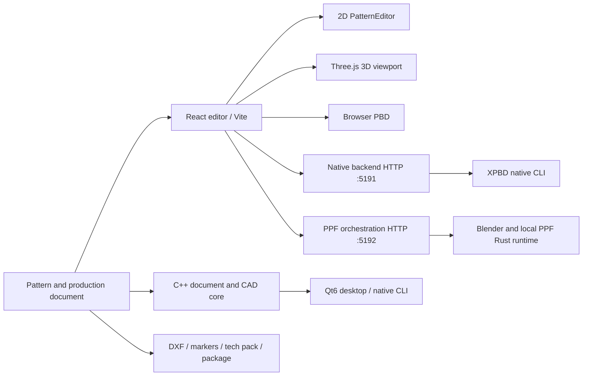
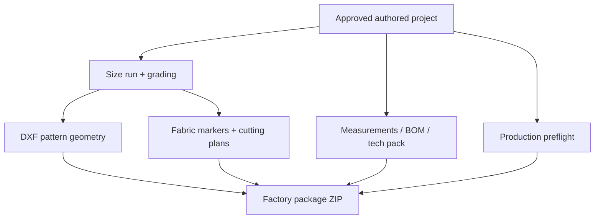

# EXO Sample 3D — Architecture and Execution Boundaries

> **Status:** Engineering reference, 15 October 2026. EXO Sample 3D is the project identity used in these guides; historical source identifiers remain `garment-studio`. This document describes source-visible functionality, not a production certification or a claim of one-to-one CLO compatibility.

## Contents
1. [System overview](#system-overview)
2. [Repository subsystem map](#repository-subsystem-map)
3. [Application state and control flow](#application-state-and-control-flow)
4. [Geometry and simulation execution](#geometry-and-simulation-execution)
5. [Native C++ and Qt](#native-c-and-qt)
6. [Rust PPF process boundary](#rust-ppf-process-boundary)
7. [Materials and rendering](#materials-and-rendering)
8. [Manufacturing and export](#manufacturing-and-export)
9. [Observability and verification](#observability-and-verification)
10. [Architecture priorities](#architecture-priorities)

## System overview

EXO Sample 3D is a garment authoring environment that combines planar patterns, sewing relationships, rendered assembly, cloth dynamics and factory handoff artifacts. Several execution implementations coexist. The React/Vite browser editor is the most directly inspectable interactive entry point (`src/main.jsx`, `src/App.jsx`, `src/components/CloUI.jsx`). Browser graphics use Three.js, with `src/components/GarmentViewport.jsx` and `src/components/PatternEditor.jsx` presenting coupled 3D and 2D experiences. A native desktop and computational CAD path lives under `native_cpp`, and native execution services run locally as Node HTTP processes. The PPF path uses an external local runtime orchestrated by `ppf_backend/server.mjs`.



This drawing shows integration and ownership boundaries, not a promise that all clients expose equal controls or that all solver outputs are numerically equivalent. Rendered fabric appearance and physical parameterization are separate concerns. Pattern coordinates are authored in centimeters; native collision and fabric thickness paths also handle meters. No implicit equivalence between centimeters and meters is safe.

## Repository subsystem map

| Layer | Main paths | Current responsibility |
|---|---|---|
| Browser entry | `index.html`, `src/main.jsx`, `src/App.jsx` | Mounts the workspace, coordinates application state |
| Authoring controls | `src/components/CloUI.jsx`, `PatternEditor.jsx`, `RightToolPalette.jsx` | Selection, editable pattern geometry, menus and commands |
| 3D viewport | `src/components/GarmentViewport.jsx` | Avatar, garment mesh presentation, interaction and rendering |
| Canonical JS geometry | `src/core/project.js`, `draftingPrecision.js`, `draftingTopology.js`, `draftingSplit.js`, `draftingUnfold.js` | Boundaries, curves, transforms, operations and geometry utilities |
| Sewing and fittings | `src/core/sewingConstruction.js`, `trims.js`, `staging.js` | Seam and hardware/assembly specifications |
| Dynamics | `src/core/physics.js`, `src/core/physics/*`, `src/core/clothMeshing.js` | Browser simulation, collision passes, mesh and quality diagnostics |
| Solver abstraction | `src/core/backends/*` | Backend discovery, protocol, normalized payloads, service adapters |
| Factory workflows | `src/core/factoryPackage.js`, `productionPreflight.js`, `marker.js`, `grading.js`, `measurements.js` | Size variants, checks, cut layouts, production files |
| Native CAD | `native_cpp/core/*`, `native_cpp/cli/main.cpp` | C++17 computational counterparts and JSON transactions |
| Native UI | `native_cpp/desktop/*`, `native_cpp/CMakeLists.txt` | Optional Qt6 desktop executable |
| Native solver | `native_backend/src/*`, `native_backend/server.mjs` | Local XPBD CLI and service |
| PPF adapter | `ppf_backend/server.mjs`, `src/core/backends/ppfPayload.js` | Job orchestration, input assembly, previews, acceptance checks |
| Blender | `blender_bridge/*` | Optional external Blender integration and tests |

The directories contain both live modules and development experiments. Existence in `native_cpp/core` indicates code has been authored; operational completeness requires compilation, parity validation, integration into the active entry point and behavioral tests on realistic garments.

## Application state and control flow

A project is the logical source of truth. The default fixture is created by `createDefaultProject()` in `src/data/defaultProject.js`, with references to pattern pieces, seam endpoints, material assignments, avatar, simulation settings and revision metadata. `src/core/project.js` exposes `cloneProject`, `touchProject`, geometric sampling and length calculations. `touchProject` increments `revision` and updates `updatedAt`; treat this as a document change indicator, not as a distributed transaction clock.

The state path typically begins in React workspace controls, applies a change to a cloned or derived garment project, updates revision, then recalculates only the affected derived assets. A point edit changes sewing-line geometry, allowance geometry, tessellated meshes, potential seam constraint sampling and manufacturing footprints. A purely visual roughness adjustment should not move simulated particle positions. `src/core/visualOnlyChanges.js` and `src/core/liveDrapeTransfer.js` are useful checkpoints when isolating those behaviors.

Pattern geometry is a data model, not a bitmap representation. Piece vertices are `{x,y}` points; optional `curves` describe control positions for quadratic edges; `sampleEdge` and `samplePieceBoundary` produce sampled contours. Arc-length operations in `src/core/draftingPrecision.js` handle curved seam edges. Geometry consumers must know whether the requested contour is a stitch line, a seam-allowance offset or a cutting line. A cut boundary derived from `seamAllowanceBoundary` must not be treated as the seam correspondence used by the simulation.

Undo and revision semantics differ by implementation: C++ `garment::Document` in `native_cpp/core/garment_document.hpp` exposes `validate()`, `summary()`, `edgeInfo()`, `seamInfo()`, `apply(operation, arguments, expectedRevision)`, and `restore(snapshot)`; `Transaction` captures `inverseSnapshot`, change flag and revisions. That typed native interface should be treated as a distinct boundary until end-to-end browser ↔ native persistence is proven.

## Geometry and simulation execution

The JS backend registry in `src/core/backends/registry.js` initially registers `browserPbdBackend` and `nativeServiceBackend`. It exports `registerSimulationBackend`, `replaceSimulationBackend`, `getSimulationBackend`, `listSimulationBackends` and `createSimulationSession`. Registered backends require `create` and `step`; asynchronous implementations must expose `stepAsync`. A backend entry's `maturity` and `capabilities` metadata are informative but cannot replace fixture-based validation.

`src/core/backends/protocol.js` declares `garment-studio.simulation`, protocol version `1`. `buildSimulationRequest` normalizes project identifiers, avatar, fabrics, pieces, seams, fasteners and requested outputs. It derives `pattern.pointsCm` and `pattern.boundaryCm` and serializes material density as `densityGsm`, thickness as `thicknessM`. `validateSimulationRequest` rejects empty piece lists, missing or duplicate piece IDs, invalid point arrays and seams referencing absent pieces. These are protocol shape checks, not proof that any particular garment can be physically assembled.

Browser dynamics are implemented through `src/core/physics.js` and related files including `avatarContactPass.js`, `selfCollision.js`, `meshQuality.js`, `qualityTriangulation.js`, `timestep.js` and `qualityGate.js`. These include several quality and contact stages. Treat frame-zero staging, collision correction, seam stabilization, contact friction and frame-to-frame state as separate measurable invariants; convergence to visually reasonable positions alone is insufficient to demonstrate parity.

Native XPBD uses a local HTTP boundary, `native_backend/server.mjs`, binding to `127.0.0.1:5191` by default with override variables `GS_NATIVE_HOST` and `GS_NATIVE_PORT`. It builds or checks `native_backend/bin/garment_xpbd_cli` and invokes that binary for a bounded number of frames. `GET /health` checks availability and `POST /simulate` consumes a body with `project` and optional quality/frame controls. The service builds its own native payload through `src/core/backends/nativePayload.js`. The call path is a local process RPC, not a direct in-browser WASM solver.

Quality preset mappings in the service include draft/preview distance constraints and quality/ultra strain-triangle cloth with isometric-XPBD bending. Those names indicate algorithm configuration. They are not a guarantee of stable cloth in all garments, accurate self-contact or physical fit certification. Experimental `experimentalSewFirst` and more advanced contact assembly features need explicit tests.

## Native C++ and Qt

`native_cpp/CMakeLists.txt` targets C++17 and defines the `garment_cad_core` static library plus `garment_cad_cli`. It includes drafting, meshing, DXF, production, materials, avatar contact, cloth analysis, solver payload and backend integration modules. Its `garment_document.hpp` uses `nlohmann::json` to preserve heterogeneous source properties while providing typed inspection and transaction behavior.

Qt6 is optional: the CMake file probes `Qt6 6.4` Widgets and conditionally defines `GarmentStudioQt` under `native_cpp/desktop`. An installed SDK is distinct from a compiled and fully feature-parity desktop UI. The React editor and Qt program are separate applications; common native library code does not automatically connect every browser interaction to the Qt canvas.

To inspect the core locally, configure and build from a clean out-of-tree directory:

```sh
cmake -S native_cpp -B native_cpp/build -DCMAKE_BUILD_TYPE=Debug
cmake --build native_cpp/build --parallel 4
ctest --test-dir native_cpp/build --output-on-failure
```

Requirements include a working C++17 toolchain, CMake ≥ 3.20, LibXml2, CURL and optional Qt6 Widgets; Apple targets also link platform image frameworks. Existing local generated build directories are build artifacts, not source dependencies. The actual active build may report library/package availability limitations on other operating systems.

## Rust PPF process boundary

The PPF orchestration server is `ppf_backend/server.mjs`, defaulting to local `127.0.0.1:5192` through `GS_PPF_HOST` and `GS_PPF_PORT`. It references a configurable Blender executable (`BLENDER`) and runtime (`PPF_RUNTIME`), with a local macOS ARM64 runtime path as default. The referenced runtime contains native `ppf-cts-server` and `ppf-contact-solver` programs; it is an external runtime, not Rust source wholly implemented in this repository.

The PPF service provides `GET /health`, `POST /jobs`, `GET /jobs`, per-job endpoints and preview access. Jobs track phase, created/started/finished timestamps, summaries, logs, error and artifacts. `src/core/backends/ppfPayload.js` builds a solver-oriented input; `ppf_backend/fitAcceptance.mjs` and `assemblyAcceptance.mjs` evaluate returned runs. Acceptance metrics must be assessed separately from a job reaching `finished`. A process can finish while the garment remains badly positioned or contact-limited.

The PPF launcher enforces local disk-space checks, process ownership/port tracking and single active job control. Those safeguards matter because solver and Blender runs are resource-intensive. PPF may be an appropriate experimental contact path; there is no basis for claiming all cloth, body shape, stitch or continuous collision detection cases are certified. See `docs/NATIVE_PPF_INTEGRATION_CHECKPOINT_2026-10-14.md`, `docs/IPC_THOMAS_SWEPT_CONTACT_INTEGRATION_2026-10-13.md` and `docs/CLOTHCRAFT_CPP_RUST_INTEROP_2026-10-15.md` for narrower snapshots.

## Materials and rendering

`src/data/defaultProject.js` defines approximate fabric presets. Named physical inputs include `gsm`, `stretchWarp`, `stretchWeft`, `bend`, `damping`, `friction` and thickness in meters. It explicitly warns that PPF-inspired fabric family properties are not equivalent to laboratory calibrated or PPF normalized elastic properties.

PBR and surface procedural paths include `src/core/fabricSurfaceModel.js`, `fabricPbrGenerator.js`, `fabricPbrFileNaming.js` and `textileProcedurals.js`, with native C++ counterparts such as `fabric_surface.cpp`, `fabric_pbr_pixels.cpp` and `textile_procedurals.cpp`. Typical visual fields are base color, roughness, metalness, opacity, sheen, normal detail and map file references. Separate image appearance from mechanical cloth thickness and stiffness. A higher-resolution weave map may change the picture without affecting the triangle topology or garment fit.

## Manufacturing and export

The factory path begins with a validated project and invokes `buildSizeRun` / `gradeProject`, `buildFabricMarkers`, `buildTechPack`, `inspectProduction`, `projectToDxf`, `projectToBomXml`, and marker SVG/PDF helpers from `src/core/factoryPackage.js`. The package uses `fflate` to zip generated text and binary entries. Native counterparts include `native_cpp/core/factory_package_files.cpp`, `construction_dxf.cpp`, `marker_layout.cpp`, `measurement_export.cpp` and `production_preflight.cpp`.

Data flow for production:



A package can be generated without proving factory readiness. Preflight checks are a useful inspection layer, but the physical production workflow still needs sample sewing, pattern verification, graded-size measurements, fabric shrinkage testing, marker allowance inspection and third-party importer validation. Byte equality of two generated artifacts tests serialization; it does not prove patterns are cuttable or garments fit bodies.

## Observability and verification

Use `npm run check:backend` for backend-contract checks, `npm run check:physics` for browser dynamics, `npm run check:materials` for surface behavior, `npm run check:production` and `npm run check:factory` for factory pathways, and `npm run check:native-quality` / `npm run check:ppf-acceptance` for selected solver checks. `npm run check` runs a broad set of suites but is not comprehensive proof of every native, browser, Qt and PPF configuration.

The specialized `scripts/check-native-cpp-*.mjs` parity scripts and `native_cpp/tests/` test programs should be used to adjudicate specific ports. Record command, revision, fixture, platform, numerical tolerances, failure fields and explicitly excluded options. Different passes may disagree about metadata despite close vertex coordinates; include both in reports.

## Architecture priorities

The highest-value next step is to make each active execution path traceable to a canonical typed document and a versioned, mechanically meaningful result schema. Then extend parity testing to multi-frame tee and pants fixtures, advanced seams, avatar contact history and factory byte outputs. Finally, add interoperability fixtures that round-trip EXO-authored artifacts through independent CAD/manufacturing consumers. Any claim of `fitCertified`, `factoryCertified`, full conversion, validated continuous collision detection or CLO equivalence must be gated on those objective tests.

See also [Feature Atlas](EXO_FEATURE_ATLAS.md), [Data Model](EXO_DATA_MODEL.md), and [Developer Guide](EXO_DEVELOPER_GUIDE.md).
