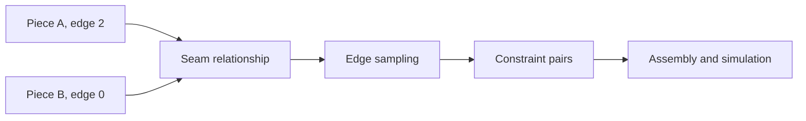

# EXO Sample 3D — Garment Document and Interchange Model

> **Scope:** The source-visible JavaScript project, simulation protocol v1, and C++ JSON document layer. Examples are illustrative subsets, not a complete, stable interchange schema. Current implementation remains experimental.

## Contents
1. [Document identity and authority](#document-identity-and-authority)
2. [Top-level project](#top-level-project)
3. [Pattern geometry](#pattern-geometry)
4. [Seam and construction graph](#seam-and-construction-graph)
5. [Fabrics and maps](#fabrics-and-maps)
6. [Avatar and physical state](#avatar-and-physical-state)
7. [Normalized simulation transport](#normalized-simulation-transport)
8. [Native document transactions](#native-document-transactions)
9. [Size runs and output models](#size-runs-and-output-models)
10. [Validation and migrations](#validation-and-migrations)

## Document identity and authority

The browser project is an object graph whose main fixtures are assembled in `src/data/defaultProject.js`. The master shape is consumed by the editor, `src/core/project.js`, manufacturing and backend payload builders. There is no separately published, immutable `EXO_DOCUMENT_V1` wire specification in the code inspected here. Therefore consumers should treat the JS shape as an evolving authoring model, `src/core/backends/protocol.js` as a distinct normalized simulation protocol and the native C++ `garment::Document` as a transactional JSON-facing facade. These boundaries are intentionally distinct.

An identifier is useful only within its scope. The project ID identifies a document; piece IDs are referenced by seams; fabric IDs are referenced by pieces; runtime request IDs correlate solver jobs. A revision changes on edits, but is not an authenticated history ledger. Avoid deriving persistent sewing identity from array position, which can shift after splits and cloning.

## Top-level project

```json
{
  "id": "illustrative-tee",
  "name": "Illustrative tee",
  "revision": 1,
  "pieces": [],
  "seams": [],
  "fabrics": {},
  "avatar": {},
  "simulation": {}
}
```

The keys above are a minimal conceptual outline, not a complete default-project export. Other consumer-owned collections include fasteners, sizes, measurement and rendering metadata. `touchProject(project)` in `src/core/project.js` mutates `revision` and `updatedAt`; `cloneProject(project)` delegates to `structuredClone` where available and JSON serialization as fallback. On old runtimes the fallback loses values not representable in JSON; all persisted project data should remain JSON compatible.

Recommended ownership boundaries:

| Canonical meaning | Owner | Derived consumer |
|---|---|---|
 Piece geometry and edge IDs | Project `pieces` | 2D drawing, mesh builder, cutting geometry |
 Seam correspondence | Project `seams` | 3D assembly, manufacturing seam reports |
 Fabric selection | `piece.fabricId` and `fabrics` | Material renderer, cloth coefficients, BOM |
 Avatar configuration | `avatar` | Staging, contacts, measurements and preview |
 Solver settings | `simulation` | Backend configuration and frame state |
 Measurements and grading | Project + grading inputs | Graded patterns, size tables and tech pack |
 Export files | Derived package | Downstream manufacturer and interoperability QA |

The distinction between authored and derived data is operational: derived triangles and texture pixels should be rebuildable from the project and relevant asset inputs. Cache invalidation can use document revision and more granular fingerprints, but caching must not silently alter geometry or physics.

## Pattern geometry

A pattern piece uses `points` with `x`, `y` coordinates in centimeters. Each consecutive pair, wrapping at the end, defines one boundary edge. The optional `curves` collection contains per-edge quadratic controls `cx` and `cy`. `src/core/project.js` contains `sampleEdge(piece, edgeIndex, segments)`, `samplePieceBoundary(piece, segments)`, `edgeLength(piece, edgeIndex)`, `edgeRangeLength(...)` and `seamAllowanceBoundary(piece,...)`.

```json
{
  "id": "front",
  "name": "Front panel",
  "points": [
    {"x": 0, "y": 0},
    {"x": 30, "y": 0},
    {"x": 30, "y": 60},
    {"x": 0, "y": 60}
  ],
  "fabricId": "main",
  "cutQuantity": 1,
  "seamAllowance": 1,
  "edgeSeamAllowances": {"1": 1.5},
  "grainAngleDeg": 90,
  "layerIndex": 0
}
```

The numerical values and shape above are synthetic. Fabric and seam IDs need to exist for production usage. `edgeSeamAllowances` can override a global seam allowance for specific edges; `getEdgeSeamAllowance` clamps finite overrides to nonnegative numbers. `seamAllowanceBoundary` samples the polygon and offsets it, with a capped miter distance at narrow angles. It is a geometric approximation and should be verified around concave corners, small radii and notches before cutting.

Drafting details are represented through optional piece fields such as `internalLines`, `notches`, `pins`, `surfaceAttachments`, `topstitches`, `bindings`, `graphics`, `arrangement3d`, `simulationResolution`, `strengthened`, `locked`, `generatedRole`, `fusedToPieceId` and `fuseStiffness`. Not all consumers serialize every property. `src/core/factoryPackage.js` uses a richer subset for documentation, and `src/core/backends/protocol.js` normalizes the simulation-relevant subset.

Grain angle expresses fabric orientation in the cutting plane; it is independent of how a panel is rotated or positioned on the avatar. The `grainAngleDeg` field must be preserved through transformations unless the operation explicitly adjusts material axes. Physical stretch in warp and weft is direction dependent.

## Seam and construction graph

The seam graph is distinct from mesh adjacency. A seam object identifies two references, conventionally `a` and `b`, containing `pieceId` and edge selection. The protocol normalizer also carries `reverseB`, `ratio`, `easeSide`, `gatherSide`, `elasticRatio`, `openFraction`, and `junctionScale`. Partial edge ranges can use `startT` and `endT` coordinates normalized to the selected edge interval. `src/core/project.js` includes `edgeRangeLength`, whose implementation currently measures length fraction using the full edge length.

The combination of seam endpoint direction and reversed-B ordering matters. For example, reversing the second edge changes how equal normalized fractions are paired; a high-level assertion that a seam exists is insufficient to reconstruct stitches. Constrained meshing may sample points along each edge and establish particle pairs. Multiple seam systems with the same endpoints can generate different particle histories because stitching cadence, force model and attachment constraints differ.



Fasteners and construction annotations should be treated as separate records, not silently reduced to plain seams. Some garment features have corresponding mechanical constraints; others currently affect production documentation or rendering only. The `sewingConstruction.js`, `trims.js` and `factoryPackage.js` paths indicate their respective responsibilities.

## Fabrics and maps

`fabrics` is keyed by fabric identifier. `src/data/defaultProject.js` defines presets, including cotton jersey, French terry and rigid denim, with additional PPF-family-inspired variants. The mechanical subset includes `gsm`, `thickness`, `stretchWarp`, `stretchWeft`, `shrinkWarp`, `shrinkWeft`, `bend`, `damping`, and `friction`. Visual parameters include `color`, `roughness`, `metalness`, `sheen`, `sheenRoughness`, `normalStrength`, `fiberAnisotropy`, `fiberAngleDeg`, `clearcoat`, `colorVariation`, and `weaveScaleCm`.

Mechanical `thickness` is in meters; a production report may multiply by 1,000 to display millimeters. `gsm` is grams per square meter, not kilograms per square meter. Stretch and shrink components are unit fractions, not percentages: `0.12` represents 12%. These fields cannot be interchanged with normalized Young's modulus or bending coefficients from an external solver merely because labels resemble one another. Constitutive mapping requires explicit calibration and unit conversion.

Visual texture references are held in a fabric `texture` object; `factoryPackage.js` records fields such as `name`, `normalName`, `roughnessName`, `metalnessName`, `opacityName` and `displacementName`. The factory and renderer may use different projections, color spaces and bit depths. For physically sensible shading, normal textures are vector perturbations and roughness textures are scalar maps; a display preview is not the same as preserving original source texture bytes in a package.

Procedural fabric code is located in `src/core/textileProcedurals.js`, `src/core/fabricSurfaceModel.js`, and `src/core/fabricPbrGenerator.js`. Their C++ counterparts require their own parity fixtures for pixel generation, random seed behavior and representation. A visual-only material operation should preserve existing positions and velocity history, while a mechanical parameter change may correctly invalidate the solver state.

## Avatar and physical state

An authored `avatar` object is passed into simulation payload generation. Mesh-based collision uses avatar triangles and nearest geometry logic in `src/core/meshAvatarContact.js` and native `native_cpp/core/mesh_avatar_contact.cpp`. Other contact flows are in `avatarContactPass.js`, `avatar_surface_correction.cpp`, and `avatar_physics.cpp`.

Keep three concepts separate: avatar visual rendering, avatar collision representation, and avatar measurement data. A visible mesh is not necessarily the exact collision mesh. Cloth particles live in three-dimensional simulation coordinates; drafting points live in two-dimensional centimeter coordinates. The solver builder owns explicit conversion and initial placement.

Contact telemetry such as penetration counts, clearances and projected correction lengths is diagnostic. It does not independently establish a certified fit. The previous-position buffer is important to implicit velocity, damping and friction. If positions match between JS and native after a frame but previous positions differ, future frames can diverge; tests should compare both.

## Normalized simulation transport

`src/core/backends/protocol.js` defines:

```text
protocol = garment-studio.simulation
version  = 1
request  = {protocol,version,requestId,project,avatar,fabrics,pieces,seams,
            fasteners,settings,requestedOutputs}
```

`project` in this transport is a small identity envelope containing `id`, `name`, `revision`, and `units: "cm"`; it is not the full authored project. A normalized piece records `pattern.pointsCm`, sampled `pattern.boundaryCm`, curves and internal lines, plus `attachments` including pins, surfaces and fusion properties. A normalized fabric records `densityGsm`, `thicknessM` and mechanical coefficients. The default requested outputs are `positions`, `normals`, `strain` and `contact`.

`validateSimulationRequest` performs structural checking: protocol ID/version; at least one piece; valid piece IDs and at least three points; seam references to known piece IDs. Do not mistake passing this validation for a closed, correctly winding polygon, a non-self-intersecting piece, watertight avatar or well-conditioned constraint graph. Additional preflights in `src/core/backends/nativeAssemblyPreflight.js` and production tooling have narrower domain responsibilities.

`backendResultSummary` reduces a returned result to `backendId`, `protocolVersion`, `pieceCount`, `frame`, and `stats`. Preserve the full response when testing mechanical parity; reduction can discard errors in individual geometry fields.

## Native document transactions

In `native_cpp/core/garment_document.hpp`, `garment::Document` accepts a `nlohmann::json` initial project and exposes immutable `data()` access, `validate()`, `summary()`, geometric inspection and `apply()`. `apply(operation, arguments, expectedRevision)` returns `Transaction`, including `beforeRevision`, `afterRevision` and an `inverseSnapshot` for undo. `restore(snapshot)` restores data. `Point2` is a simple double-precision centimeter coordinate.

For callers, the safe pattern is to fetch a known revision, construct an operation, apply with that expected revision, and retain the inverse snapshot for undo. The exact supported operation strings should be inspected in `native_cpp/core/garment_document.cpp` before building a new client. Do not assume arbitrary JSON Patch or REST transaction semantics. Native and browser operations should be compared at a canonical serialized data level, especially around unknown extension properties, defaults and revision increments.

## Size runs and output models

`src/core/grading.js` derives sizes and graded variants, while `src/core/marker.js` and `src/core/markerArtifacts.js` build cut layouts and SVG/PDF representations. `src/core/dxf.js` projects editable outlines into DXF, and `src/core/factoryPackage.js` composes many documents including technical descriptions, BOM XML, markers, cost tables, size runs and production preflight files.

Production outputs are snapshots, not interchangeable authoring sources. DXF captures drafting entities and geometric conventions, a tech pack describes specifications and materials, and marker output records cut arrangements. Exact byte parity between implementations must be evaluated per output file: JSON key insertion order, number formatting, DXF entity ordering, newlines and ZIP entry ordering all affect bytes without necessarily changing geometry.

## Validation and migrations

For each new schema field, define ownership, defaults, unit, accepted range, serialization path, backwards compatibility and validation. A proposed schema migration should include a fixture from an older revision, a round trip through the browser project model, a native document transaction, and a production serialization check. Unknown extension fields should be preserved when possible and explicitly dropped only when the target format cannot represent them.

Additional high-priority invariant tests include: closure and orientation of curved boundaries; stable seam references after split/unfold; edge range correspondence; material axis preservation through grading; deterministic quality triangulation; contact state across two or more frames; size-run measurement monotonicity where expected; and round-trip importer tolerance.

See [Architecture](EXO_ARCHITECTURE.md), [Feature Atlas](EXO_FEATURE_ATLAS.md), and [Developer Guide](EXO_DEVELOPER_GUIDE.md).
