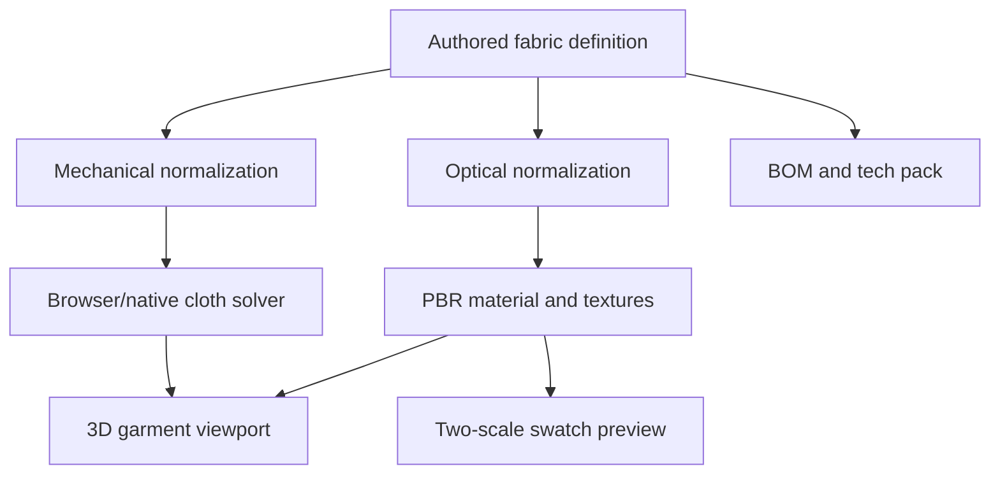

# EXO Sample 3D: Fabric Materials, Textile Optics, and Trims

> Technical reference for the current EXO Sample 3D source, October 2026. The project provides interactive fabric authoring, PBR previews, procedural textures and construction metadata. Its presets are useful starting values and are not laboratory-calibrated material certificates.

## Contents

1. [Material system architecture](#material-system-architecture)
2. [Fabric authoring and assignment](#fabric-authoring-and-assignment)
3. [Mechanical cloth properties](#mechanical-cloth-properties)
4. [Optical material properties](#optical-material-properties)
5. [PBR maps and color-space handling](#pbr-maps-and-color-space-handling)
6. [Procedural weave and physical scale](#procedural-weave-and-physical-scale)
7. [Two-scale material preview](#two-scale-material-preview)
8. [Swatches, color consistency, and provenance](#swatches-color-consistency-and-provenance)
9. [Hardware, stitching, and trim data](#hardware-stitching-and-trim-data)
10. [Live updates and caching](#live-updates-and-caching)
11. [Native equivalents and parity](#native-equivalents-and-parity)
12. [Quality gates and future work](#quality-gates-and-future-work)

## Material system architecture

The browser fabric pipeline connects authored materials to both cloth behavior and appearance. Defaults and named presets are defined in `src/data/defaultProject.js`; `src/core/fabricSurfaceModel.js` normalizes optical settings; `src/core/textileProcedurals.js` generates textile map data; `src/core/fabricPbrGenerator.js` and `fabricPbrFileNaming.js` support map creation/naming; `src/components/FabricMaterialPreview.jsx` shows the dedicated preview. `src/components/GarmentViewport.jsx` applies material properties to the 3D garment. The surrounding authoring interface lives in `src/App.jsx` and `src/components/CloUI.jsx`.

Two categories must stay conceptually separate. **Mechanical properties** influence simulation forces and contacts: mass per area, resistance to stretching, bending response, damping, thickness and friction. **Optical properties** influence light transport and display: color, roughness, sheen, anisotropic highlights, metalness, opacity, normals, and displacement. Texture maps can describe fine fibers without modifying solver particles. Visual displacement is explicitly limited in the optics code and is not a substitute for a physically thick collision shell.

The source supports a fabric dictionary keyed by material ID, with garment pieces referencing that ID. The same material can be assigned to multiple pieces, but each piece may have distinct grain direction or geometry. A future system of material overrides should define whether changes are applied globally to the fabric asset or to a single panel instance. For now, trace the source fabric ID and piece assignment before modifying a shader or solver payload.

## Fabric authoring and assignment

The named preset library in `src/data/defaultProject.js` includes cotton jersey, heavy French terry, rigid denim, silk twill, fusible interfacing and additional families inspired by PPF source materials. Expanded examples include cotton poplin, cotton canvas, wool suiting, wool melton, soft garment leather, suede, lightweight nylon and ripstop. Every preset is an authoring starting point and needs verification before being used as a physical textile specification.

The initial jersey object, for instance, carries `gsm: 220`, `stretchWarp: 0.12`, `stretchWeft: 0.18`, `bend: 0.68`, `damping: 0.985`, `friction: 0.34`, `thickness: 0.002`, and a neutral color. This is an example of the program's parameterization rather than a statement about all cotton jersey. The relatively large nominal thickness illustrates why the values should not be treated as literal lab measurements; the solver and render environment may use approximation-specific scaling.

A reliable fabric editor should display the field unit, accepted range, and whether the parameter is physical, visual, or manufacturing metadata. The renderer can interpret `roughness` directly as a shader scalar, but a physical solver may map `bend` and stretch fractions into its own constraint stiffness model. Exposing the same user-friendly labels across backends does not establish equivalent force laws.

Fabric assignments also affect production. `src/core/factoryPackage.js` iterates `project.fabrics`, counts pieces and cut quantities per fabric, and estimates total pattern area. It emits fields including GSM, thickness in millimeters, optical settings, weave family and named PBR maps into material tables. Always verify BOM fabric totals against piece quantity and effective marker layout rather than assuming raw polygon area is a final cutting consumption figure.

## Mechanical cloth properties

The simulated garment starts with a mesh generated from authored 2D pieces. Fabric density expressed in grams per square meter helps determine mass distribution; thickness, bend, stretch and friction influence its response. In `src/core/backends/protocol.js`, normalized fabric payloads use `densityGsm`, `thicknessM`, `stretchWarp`, `stretchWeft`, `shrinkWarp`, `shrinkWeft`, `bend`, `damping` and `friction`. The bridge makes dimensional units explicit for the backend.

Stretch and shrink numbers are fractional, so `0.12` means twelve percent. `gsm` has units grams per square meter; `thicknessM` is in meters. No one should substitute a value expressed in millimeters for meters without conversion. Grain orientation, stored on pieces as `grainAngleDeg`, rotates the material's warp/weft axes relative to panel geometry. A woven fabric can respond differently to cross-grain extension even when the panel cut silhouette is unchanged.

The browser physics source is `src/core/physics.js`, with implementation helpers in `src/core/physics/`. The native XPBD service under `native_backend` and PPF orchestration under `ppf_backend` are separate execution paths. The preset comment in `defaultProject.js` explicitly warns that PPF-family-inspired material names are approximations; normalized Young's modulus and bending inputs from another solver cannot be copied directly into this solver and expected to produce comparable motion.

Calibration must therefore occur on actual measured fabric samples. A practical protocol uses a known-size hanging drape, uniaxial stretch tests in warp and weft, controlled bending strips, and sliding/friction observations. Photograph the specimen with a scale reference and record the target fabric GSM, construction, conditioning and stretch loads. Optimize model parameters against quantitative displacement and folding measurements, rather than merely matching a thumbnail.

Physical acceptance should include equilibrium drape, repeated time steps, seam strain, avatar contact and changes under pose variation. A solver showing a smooth skirt is not sufficient if its hem floats above the body or its previous-position buffers diverge between frames. Run at least two successive frames and compare cloth positions and contact telemetry when evaluating browser/native parity.

## Optical material properties

`normalizeFabricOptics` in `src/core/fabricSurfaceModel.js` clamps optical parameters. Relevant bounds include opacity `0.05–1`, visual displacement `0–2` mm, roughness `0.04–1`, metalness `0–1`, sheen `0–1`, sheen roughness `0.04–1`, normal strength `0–4`, fiber anisotropy `0–1`, fiber angle `-180–180°`, clearcoat `0–1`, clearcoat roughness `0.04–1`, color variation `0–1` and weave scale `0.3–10` cm. These finite clamps prevent obvious invalid shader values and provide predictable UI ranges.

Roughness controls microfacet highlight width; metalness changes shader reflectance assumptions. Most untreated cloth should remain predominantly dielectric, with low metalness, although decorative metallic coatings can require different behavior. Sheen adds a grazing-angle fabric highlight, while anisotropy can represent fiber-directed reflections. Clearcoat is appropriate for coatings or treated surfaces, not a universal fabric gloss knob. Opacity models optical transmission/alpha and must be interpreted separately from actual fabric air permeability.

Normal maps perturb apparent surface orientation without adding triangles. Displacement maps can move rendered vertices, but their fidelity depends on polygon density. A `displacementMm` value is explicitly optical in the source and does not expand the avatar collider or the cloth's simulated volume. Strong displacement on a low-resolution mesh can create inaccurate contours; normal maps are generally preferable for high-frequency yarn relief unless silhouette changes are intentional.

Opacity additionally impacts draw order and depth writing. `FabricMaterialPreview.jsx` sets `transparent` for low opacity or a provided opacity map, and disables `depthWrite` in that case. This can help prevent false occlusion, but overlapping translucent panels still need explicit inspection. Test chiffon and organza across front and back sides, over the avatar and over darker underlayers.

## PBR maps and color-space handling

The preview uses `THREE.MeshPhysicalMaterial` with separate slots for base-color (`map`), normal, roughness, metalness, alpha and displacement. Fabric texture data uses names including `src`, `normalSrc`, `roughnessSrc`, `metalnessSrc`, `opacitySrc`, `displacementSrc`, `repeatWidthCm`, `repeatHeightCm`, and `rotationDeg`. The renderer builds owned texture instances with wrapping and rotation settings.

Color space is particularly important. The preview labels base-color textures with `THREE.SRGBColorSpace`; normal, roughness, metallic, opacity and displacement textures use `THREE.NoColorSpace`. Color maps describe encoded visible colors and require the appropriate sRGB decoding. Data maps store values used mathematically and must not receive color correction that alters normals or scalar roughness.

The preview renderer emits sRGB display output with ACES tone mapping and exposure `1.15`. The main garment viewport has its own studio lights and exposure. Because the environments differ, a textile may show different apparent brightness in the swatch and full garment. Future capture tests should provide a shared calibrated lighting reference and compare color within a known tolerance. A photo or hex color cannot promise dye match across displays.

Image provenance is also essential. The project should distinguish user-uploaded image maps from procedural maps, record source filename or asset ID, and preserve permission status. Generated source maps should be deterministic under the same seed and settings. Production exports should record material definitions separately from bundled texture binary assets; a filename appearing in a tech pack does not demonstrate that the file was embedded in the archive.

## Procedural weave and physical scale

`src/core/textileProcedurals.js` generates PBR textile maps based on fabric families and structural settings. The material pipeline includes controls for fiber direction, weave scale, color variation and repeat dimensions. Procedural texture detail can capture visual cues of jersey loops, twill diagonals, fleece texture or ripstop reinforcement without importing a photograph for every material.

The critical distinction is between the scale of a sampled preview and a garment-sized map. A fiber pattern only fractions of a millimeter wide may disappear when the whole garment is reduced to a few hundred pixels. Naively stretching the texture until visible destroys physical scale. The solution is multiple preview scales, appropriate mipmapping/texture filtering and explicit centimeter repeats.

For a pattern piece, UV orientation should follow the piece geometry and grainline. If the geometry is rotated in world space, fabric direction should remain attached to the garment, unless the user intentionally changes grain. Texture `rotationDeg` is a visual transform and should not silently alter mechanical warp/weft constraints. A plaid or striped textile additionally requires panel-level pattern matching, which is more demanding than generating repeating UVs.

Procedural parity tests should measure the pixels, not just whether a map exists. The same preset, seed, dimensions, pixel encoding and sampler should yield consistent color, height, normal and roughness buffers. JavaScript and C++ implementations may differ in number rounding and noise order; fixtures must test normal-map orientation, roughness channel values and repeat continuity.

## Two-scale material preview

`src/components/FabricMaterialPreview.jsx` implements an independent, low-power WebGL preview. It renders a 96×64-segment sphere beside a 20×20-segment planar swatch. The sphere presents the overall optical finish, while the swatch uses macro-scale UV coordinates to represent an approximately 1.8 cm fabric patch. This deliberate pairing solves a common presentation problem: very fine weave can vanish under texture minification on a distant sphere.

The preview viewport is initialized at `260×172` with a perspective field of view of `38°`, a fixed camera and a hemisphere/key/fill lighting arrangement. Pointer motion rotates the material sphere and tilts the swatch slightly. It is not a cloth solver. The swatch geometry may be tessellated for rendering but does not indicate simulated elasticity, seam behavior or full garment performance.

The code computes swatch UVs using `repeatWidthCm` and `repeatHeightCm`, defaulting to twenty-centimeter repeat dimensions. It recomputes image map textures only when a serialized material signature changes; optical scalar changes update the existing material. After every update, it renders the result. On teardown it disposes textures, geometry, material and renderer, releases the WebGL context and removes the canvas. These operations matter when opening many fabric panels over a long authoring session.

The swatch and sphere should eventually share named lighting rigs with the main viewport. Add a known neutral sample, gray card or color calibration element, a viewing-distance toggle and controls for inspecting individual channels. A diagnostic mode could display normal, roughness and alpha maps independently, revealing imported-map mistakes that a beauty render can conceal.

## Swatches, color consistency, and provenance

A material preset is an engineering bundle, not a dye lot. The source currently supports color strings and texture maps but does not establish spectrophotometric measurement, ICC-managed print proofing or physical color matching. For production, store a color standard and real swatch reference alongside digital appearance settings. Record illumination assumptions, display tone mapping, material opacity and a photographic reference with a neutral gray target.

UI color pickers should present a readable hex/sRGB value, a reproducible preview and clear warnings about physical manufacturing equivalence. Avoid deriving the physical color of a shiny fabric solely from a screen pixel under a bright environment. For dark fabrics, inspect shadow detail and highlight behavior; for white fabrics, preserve stitching and fold relief without clipping.

The existing public studio can use the neutral CC0 MakeHuman visual avatar under `public/avatars/makehuman-base.obj` and the nonproprietary floor grid built in `GarmentViewport.jsx`. This provides a consistent scale and lighting context for fabric comparisons. Use that setup in public screenshots and avoid nonpublic avatar sources. Screen captures should include the current EXO Sample 3D identity and should not imply that every material option has been mechanically certified.

## Hardware, stitching, and trim data

Trims combine aesthetics, geometry, construction and bill-of-material requirements. Their authored paths include `src/core/trims.js`, `src/core/sewingConstruction.js`, associated UI controls in `src/components/CloUI.jsx` and production generation in `src/core/factoryPackage.js`. Representative classes include buttons, buttonholes, zippers/fasteners, bindings, topstitch specifications, applied graphics and other hardware annotations.

Different trim types demand different data. A button needs size, quantity, attachment positions, material/finish and potentially replacement information. A buttonhole needs its placement, orientation, length and stitch construction. A zipper has paired edges, opening direction, tooth or tape specifications, length and hardware finish. Binding needs width, type, fold and consumption data. Topstitching needs path, offset, seam relationship, thread specification and stitch appearance. A rendering object alone is insufficient for complete construction.

The project fields visible in factory reporting include piece `topstitches`, `bindings`, `graphics`, as well as general `fasteners`. `src/core/factoryPackage.js` counts some of these records and includes related tables. That output must be checked against the complete item list before production. Graphics and hardware in a viewport should preserve physical attachment to pattern pieces after grading, splitting or resizing. A decorative zipper model that does not follow the sewn edges can misrepresent both appearance and manufacturability.

Hardware materials can use PBR settings different from cloth. Metallic fasteners may need high metalness and controlled roughness, while plastic buttons are generally dielectric. Trims often span finer texture scales than a full garment; separate UV scale controls may be appropriate. Collision and contact behavior for stiff or rigid hardware require dedicated solver representation; attaching a static visual mesh does not automatically introduce hard-body mechanics.

An eventual trim inventory should include an explicit enum/type, UUID, source piece references, 2D attachment and 3D placement, render asset, physical constraints if present, BOM unit, quantity and production notes. Preserve traceability between the on-screen instance and exported record. Do not claim reliable full zipper mechanics merely from the existence of an authored fastener or visible zip geometry.

## Live updates and caching

The editor seeks rapid iteration without restarting drape for every appearance change. Supporting code includes `src/core/visualOnlyChanges.js`, `src/core/liveDrapeTransfer.js`, and render texture-update logic in `GarmentViewport.jsx`. The preview's signature contains visual and texture fields, including `surfaceFamily`, `weaveScaleCm`, `colorVariation`, `thickness`, source texture URLs and repeat dimensions. Changing a shader scalar need not regenerate the geometry mesh.

When implementing a new field, classify it first. Color, roughness and sheen should change only optical output. Stretch, stiffness, thickness and friction can affect simulation and may require restarting or resuming from a controlled state. A UV scale edit should update UV attributes or maps while preserving particle positions. Trim attachment changes may require revisiting seam or collision constraints. These distinctions should be encoded as invalidation dependencies, not hidden in a giant unconditional viewport rebuild.

Tests should capture every simulated particle before and after a visual-only edit and require unchanged coordinates within explicit numerical tolerance. They should also confirm that the intended optical channel changed and that other fabrics were not inadvertently modified. For mechanical edits, compare re-simulation diagnostics under identical initial conditions rather than expecting unchanged drape.

## Native equivalents and parity

Native C++ implementations exist in `native_cpp/core/fabric_surface.cpp`, `fabric_pbr_pixels.cpp`, `fabric_pbr_image_generator.cpp`, `fabric_pbr_source_image.cpp` and `textile_procedurals.cpp`. They illustrate ongoing efforts to port textile definitions and pixel generation to a native core. Their existence does not imply all JavaScript defaults, formats, patterns and interpolation semantics are fully equivalent or that the Qt interface exposes every control.

Compare generated pixel buffers and JSON material descriptors for known presets. Pay attention to channel order, sRGB versus linear treatment, byte clamping, rotation, repeat scaling and reference texture loading. When parity fails, preserve the differing fixture and report the exact channel and coordinates. Avoid changing tolerant test thresholds merely to make a claim of completion.

The native physics stack also requires material mapping tests. A JSON fabric normalization may match perfectly while the resulting native solver interprets a bend parameter differently. Mechanical parity needs controlled physical scenes, not only matching descriptors. Until physical parameters are calibrated and acceptance tests established, material realism remains an experimental target.

## Quality gates and future work

The package scripts include `npm run check:materials`, which invokes `scripts/check-materials.mjs` and `scripts/check-fabric-realism.mjs`. Additional browser-facing checks include `npm run check:fabric-visual` (`scripts/qa-fabric-material-iteration.mjs`) and `npm run check:render-still` (`scripts/qa-material-render-still.mjs`). Focused native parity scripts under `scripts/check-native-cpp-*.mjs` provide further comparisons; their specific assertions must be inspected before reporting results.

| Acceptance area | Minimum meaningful verification |
|---|---|
| Optical bounds | Nonfinite and out-of-range input normalizes predictably |
| Color maps | Base color uses sRGB, data maps remain untransformed |
| Procedural textures | Deterministic pixels for stated preset and seed |
| Physical-scale weave | Repeat dimensions survive UV updates and rotation |
| Swatch viewer | Sphere and 1.8 cm patch both show the intended material |
| Live optical changes | Particle positions unchanged after color/roughness edit |
| Mechanical changes | New solver run records meaningful cloth difference |
| Trim construction | On-screen elements preserve authored attachment and BOM IDs |
| Factory output | Every assigned fabric and relevant trim appears accurately |
| Public samples | Public CC0 avatar and no unlicensed private references |

Upcoming priorities are standardized measured fabric datasets, a transparent material unit model, an optical/physical dependency graph, high-quality macro swatch comparison, calibrated fabric presets, and robust construction-aware trim objects. For production, verify fabric identity, shrinkage, cutting consumption, hardware counts and compatibility with the selected manufacturer. A convincing 3D render and a successful ZIP export are intermediate accomplishments, not a manufacturing certification.

Related guides: [UI Rendering and Avatars](EXO_UI_RENDERING_AND_AVATARS.md), [System Architecture](EXO_ARCHITECTURE.md), [Data Model](EXO_DATA_MODEL.md), and [Feature Atlas](EXO_FEATURE_ATLAS.md).
