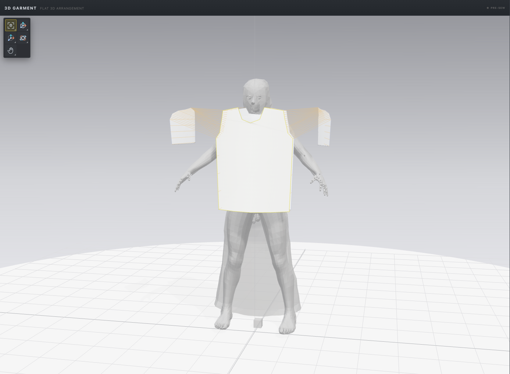
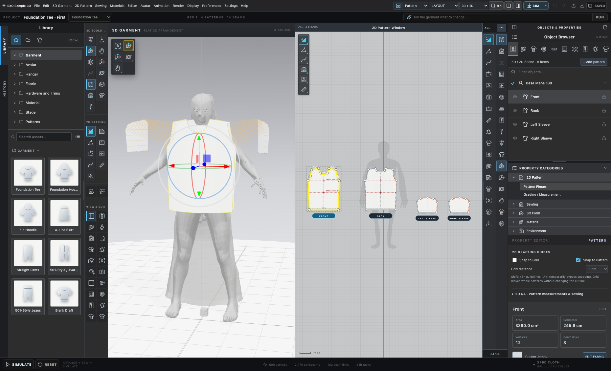

# EXO Sample 3D — visual gallery and V16 film

This document establishes what the images/video in the public repository actually show. The goal is **recent, useful visual evidence**—not polished renders that hide unfinished simulation behavior or photographs misrepresented as application results.

## Current gallery (October 2026)

All eight gallery screenshots were captured with the current React/Three.js application using an isolated **Foundation Tee** fixture, the first-party workspace UI, a neutral **MakeHuman-derived fitting avatar**, and the application's real 3D floor grid. Screen sizes are approximately 1860×1130 for full UI images; cropped viewport images inherit their rendered canvas dimensions. Lighting/shadows/textiles are actual interactive render results. These are **not output from CLO3D** or AI-generated replicas.

| Asset | Scene shown | Important limitation |
| --- | --- | --- |
| [Current linked pattern and 3D](../screenshots/exo-2026-current-pattern-and-3d-grid.png) | Editable 2D tee pieces and staged 3D geometry simultaneously | Panels are staged, not a stable sewn final garment |
| [Full 3D fitting avatar and floor grid](../screenshots/exo-2026-current-3d-garment-grid.png) | Neutral mannequin, viewport, grid, garment panels | Neutral base mesh does not prove calibrated anthropometric fit |
| [2D pattern grid](../screenshots/exo-2026-current-2d-pattern-grid.png) | Pattern point and curve guides, construction layout | Sample template only |
| [Fabric editor and garment](../screenshots/exo-2026-fabric-and-3d-grid.png) | Materials workspace beside 3D/2D | Optical controls are not physical-fabric measurement results |
| [Cropped fabric 3D](../screenshots/exo-2026-fabric-viewport.png) | 3D fabric and avatar preview | Surface shading/texture mapping remains under verification |
| [Render Studio](../screenshots/exo-2026-3d-render-studio.png) | 3D-only layout, floor grid and render inspector | Live WebGL stage, not path tracing or final product photography |
| [Neutral mannequin close view](../screenshots/exo-2026-3d-model-grid-detail.png) | Clearer neutral fitting figure on ground grid | Real staged garment, no certified simulated final shape |
| [Sewing workspace](../screenshots/exo-2026-sewing-workspace.png) | Sewing mode, panels, garment workspaces | Full complex seam/contact behavior under development |

### Natural 3D ground grid

The grid is generated by Three.js as a floor/axis reference. It is not an AI-generated floor background, and the garment model is derived from the local first-party Foundation Tee test garment. Real mannequin geometry may show a low-poly or unfinished appearance, which is more truthful than a generic fashion-model illustration.

### 2D↔3D editing

The dual workspaces are intended to support pattern drafting and immediate 3D spatial feedback. They do not themselves establish sewn fabric correctness. For real garment realism work, contributors should compare the same documented pattern under staging and time-integrated simulation and record penetration/stretch errors.

## Capture method

The repeatable gallery capture script is [scripts/capture-exo-public-gallery.mjs](../scripts/capture-exo-public-gallery.mjs). It uses Playwright Core with a locally installed Google Chrome browser and an isolated in-browser test session to avoid modifying normal saved user garments.

Start Vite in one terminal:

~~~bash
npm ci
npm run dev
~~~

From another terminal:

~~~bash
npm run capture:gallery
~~~

The browser session points to http://127.0.0.1:5173/?desktop=1&testSession=tee by default, opens a fresh isolated browser context, and visits the drafting, materials, render and sewing workspaces. Override the local origin using EXO_SCREENSHOT_ORIGIN; override Chrome executable using EXO_CHROME_PATH if needed. If the fixture is missing or WebGL can't render, the command should fail rather than output fabricated or empty “proof.”

**Rights and privacy checks before merging photos:**

- Do not capture signed-in dashboards, people, commercial third-party app UI, or private saved garments.
- Do not put the local restricted CLO/Thomas avatar or its screenshots in the public repository.
- Use project-owned graphics and demonstrably permissive/CC0 avatar imagery with appropriate license records.
- Preserve raw genuine interface evidence, including visible limitations. Only crop/resize for layout; no deceptive compositing.
- Keep screenshots to useful representative scenes. Update after meaningful UI changes instead of filling the README with old duplicates.
- A photo of a real sewn garment would require provenance, permissions and sample-fit annotations, and is **not equivalent** to a simulation screenshot.

## Full V16 promotional film

**[View the complete EXO Sample 3D V16 showcase MP4](../media/exo-sample-3d-v16-showcase.mp4)**

| Attribute | Verified detail |
| --- | --- |
| Film version | V16, from October 15, 2026 |
| Full mastered timeline | Approximately 177.1 seconds (2:57) |
| Delivery copy | H.264 video and AAC audio in MP4 |
| Repository size | Approximately 64 MB, under GitHub's 100 MB single-file limit |
| Higher-quality master | Retained in local ignored project media, not pushed |
| Source evidence | Internal V16 QA note under ignored promo working directory |
| Story coverage | App UI, pattern workspaces, native simulations in development and fabric-editing demonstrations |
| Release claim | Development film only. No certification of physical fitting, fabric-photo parity or factory readiness |

An internal V16 technical review reports that the film includes a real SIM click and moving garment, but a few textile-change shots do **not** unambiguously show the texture changed on the final 3D garment even when the material settings changed. That is an **open creative/engineering retake item**, not a reason to claim the scene proves physically accurate cloth. The status is documented here so the video can be shared without overstating its evidence.

### Future film improvements

1. Show the 2D pattern change and corresponding 3D mesh update in the same edit sequence.
2. Capture the entire Simulate-to-Pause interaction clearly with a synchronized time marker and visible solver status.
3. Show at least two verified, visually distinct fabric appearances—e.g. cotton versus denim—on the *actual 3D garment*, not merely different inspector values.
4. Explain avatar constraints, seams, layer ordering, collision/contact outcomes and known instability without suggesting factory certification.
5. Record additional explicit close-ups of avatar, fabric, hardware, Production, Render Studio, library and export interfaces.
6. Use measured values (frame durations, preflight warnings and build versions) when presenting technical claims.
7. Include author-owned or properly licensed music/audio only; keep audio license provenance with future release packages.

## Media acceptance checklist

- [x] Eight fresh current application screenshots linked from the README.
- [x] Neutral avatar and natural 3D ground grid visible.
- [x] Full V16 film committed as a normal GitHub-compatible MP4.
- [x] No restricted proprietary CLO avatar copied into the public gallery.
- [x] Simulated/factory functionality caveats in user-facing copy.
- [ ] Confirm a future professionally draped, collision-correct garment from benchmarks.
- [ ] Add measured fabric optical/physical comparisons with controlled lighting.
- [ ] Create a stronger follow-up film with visible textile-material transitions.
- [ ] Record publication permissions/provenance for future outside contributors' media.

---

Return to the [README](../README.md), the [documentation index](EXO_DOCUMENTATION_INDEX.md), or the [master roadmap](EXO_MASTER_ROADMAP.md).
